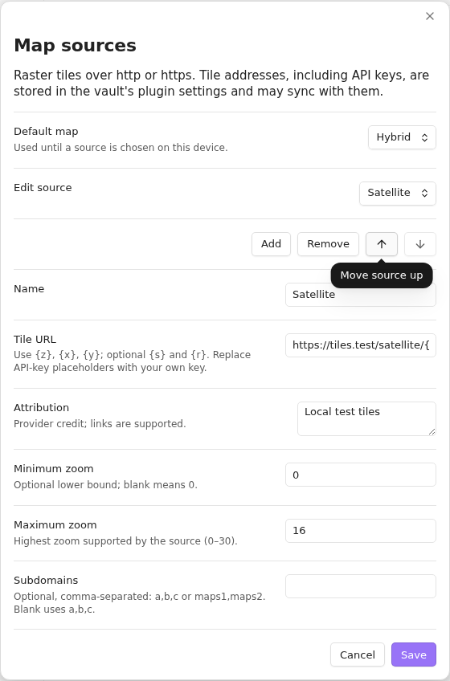
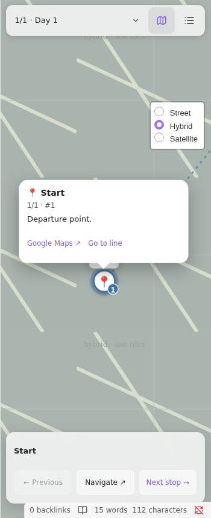

# Map sources

Configure more than one raster background in **Wayfarer → Advanced → Map sources
→ Manage map sources**. Add, edit, remove or move a source up/down, choose the
default, then Save. Cancel leaves the configuration unchanged. At least one
source is retained. Only the existing OpenStreetMap source is supplied by default.

The map's layers button switches backgrounds. It is hidden with one usable
source. The position, itinerary layers, filters and open popup stay in place;
zoom is clamped only if the selected source cannot support it. Sources are
loaded on selection, not all at once. On narrow screens the layers button
hides with the zoom buttons while a popup or the stop list is open.




Screenshots show the real Obsidian/Leaflet controls with deterministic test
tiles, rather than a commercial imagery service.

## Configuration

| Field | Meaning |
| --- | --- |
| Name | Label in the switcher; distinct names are helpful |
| Tile URL | HTTP(S) image template; normally `{z}`, `{x}`, `{y}` |
| Attribution | Provider credit, including its required links; HTML is supported |
| Minimum / maximum zoom | Whole-number bounds from 0 to 30; normally 0–19 |
| Subdomains | Optional comma-separated host labels for `{s}`, e.g. `1,2,3,4`; blank uses Leaflet's `a,b,c` |

Use **256-pixel Web Mercator (EPSG:3857) XYZ raster tiles**: PNG, JPEG or WebP.
`{r}` and `{-y}` retain their existing Leaflet support. Other templates, vector
tiles, WMS, different projections, TileJSON/style-JSON URLs and custom request
headers are not implemented. Put an actual provider key/token into the URL;
`{apikey}` is not a Leaflet placeholder. No key is bundled or required by Wayfarer.

“Hybrid” means a provider's already combined imagery-and-labels raster style.
This feature does not create overlays or combine separate services. Routing,
Google location lookup/source links and note metadata are unaffected.

The default is used when no valid device choice exists. The most recent
selection is remembered with Obsidian's device-local storage, as a source ID
only. Open map panes can choose independently; the last choice initializes
new panes. Deleting a pane's current source falls back to the configured
default, or the first usable source. Changing the shared default does not
replace a valid choice in an already-open pane.

## Provider examples

These are configuration examples, not a bundled provider catalogue. Check the
provider's current coverage, zoom limits, attribution/logo requirements,
token restrictions, quotas and terms for your use. No paid/keyed provider was
queried with a real account during testing.

| Source | Tile URL | Notes |
| --- | --- | --- |
| OpenStreetMap | `https://tile.openstreetmap.org/{z}/{x}/{y}.png` | Existing default, maximum zoom 19; [tile usage policy](https://operations.osmfoundation.org/policies/tiles/) |
| Esri imagery | `https://services.arcgisonline.com/ArcGIS/rest/services/World_Imagery/MapServer/tile/{z}/{y}/{x}` | Satellite; use service credits and limits from its [metadata](https://services.arcgisonline.com/ArcGIS/rest/services/World_Imagery/MapServer?f=pjson); availability/coverage varies by zoom |
| Mapbox hybrid | `https://api.mapbox.com/styles/v1/mapbox/satellite-streets-v12/tiles/256/{z}/{x}/{y}?access_token=YOUR_TOKEN` | Combined imagery/labels, 256-pixel endpoint; token and provider terms apply; [Leaflet example](https://docs.mapbox.com/accounts/guides/pricing/sections/third-party-tools/) |
| MapTiler streets | `https://api.maptiler.com/maps/streets-v4/256/{z}/{x}/{y}.png?key=YOUR_KEY` | Choose another raster style for outdoor/dark maps; obtain its URL/credits/limits from the [Maps API](https://docs.maptiler.com/cloud/api/maps/) |
| basemap.at | `https://mapsneu.wien.gv.at/basemap/geolandbasemap/normal/google3857/{z}/{y}/{x}.png` | Austria, Web Mercator variant; credit `Datenquelle: <a href="https://basemap.at/">basemap.at</a>`; [provider terms](https://basemap.at/#nutzungsbedingungen) |
| OpenTopoMap | `https://{s}.tile.opentopomap.org/{z}/{x}/{y}.png` | Outdoor map; check current [service limits and credit](https://opentopomap.org/about) before use |
| Self-hosted / TileServer GL | `https://maps.example.com/styles/streets/{z}/{x}/{y}.png` | Use your server's raster endpoint and supported zoom range; no Wayfarer-hosted server is needed |

Example saved settings (the dialog manages IDs):

```json
{
  "defaultMapSource": "street",
  "mapSources": [
    {
      "id": "street",
      "name": "Street",
      "url": "https://tile.openstreetmap.org/{z}/{x}/{y}.png",
      "attribution": "&copy; <a href=\"https://www.openstreetmap.org/copyright\">OpenStreetMap</a>",
      "minZoom": 0,
      "maxZoom": 19
    },
    {
      "id": "own-map",
      "name": "Own map",
      "url": "https://maps.example.com/styles/streets/{z}/{x}/{y}.png",
      "attribution": "Your data provider's required credit",
      "maxZoom": 18
    }
  ]
}
```

HTTP and private/LAN servers use the normal image loader. They must be
reachable from the device, with browser/platform TLS, mixed-content and
authentication rules still applying. There is no custom authentication flow.

## Existing installations and credentials

The previous `tileUrl` and `tileAttribution` become the first source when the
new list is absent or unusable. A custom URL and its attribution are retained,
including existing query parameters. Repeated loading does not append copies.
Migration runs in memory; it is persisted with the next settings save.
The old fields remain and mirror the configured default when the editor saves,
so an older plugin can still use that default. Notes are never migrated.

Source URLs, including embedded keys, are plain text in
`.obsidian/plugins/wayfarer/data.json`. They travel with that file if your sync
setup includes it. They are not put into Markdown, local selection storage,
plugin error messages or plugin logs. The selected server necessarily sees
tile requests; browser network tools can also show their URLs.

## Failures and scope

Invalid templates are rejected by the editor. Damaged source-list entries are
normalized on load; invalid URLs remain available for repair. The renderer
uses usable sources, with the existing OpenStreetMap fallback if none remain.
Network failures, offline mode, invalid keys or HTTP errors can leave background
tiles blank, while pins/routes remain usable. There is no per-tile notice spam
or automatic switch to another server; choose another configured source.

Only Leaflet's normal in-memory/browser image behaviour is used. No persistent
offline cache, downloads, MBTiles/PMTiles import, special Google tile API,
routing or geocoding changes are included. Google basemap sessions are outside
this feature. The feature works independently of the other fork changes.
